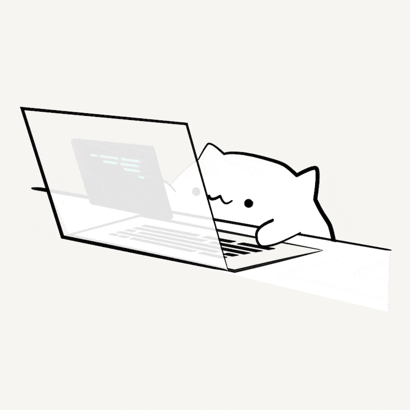
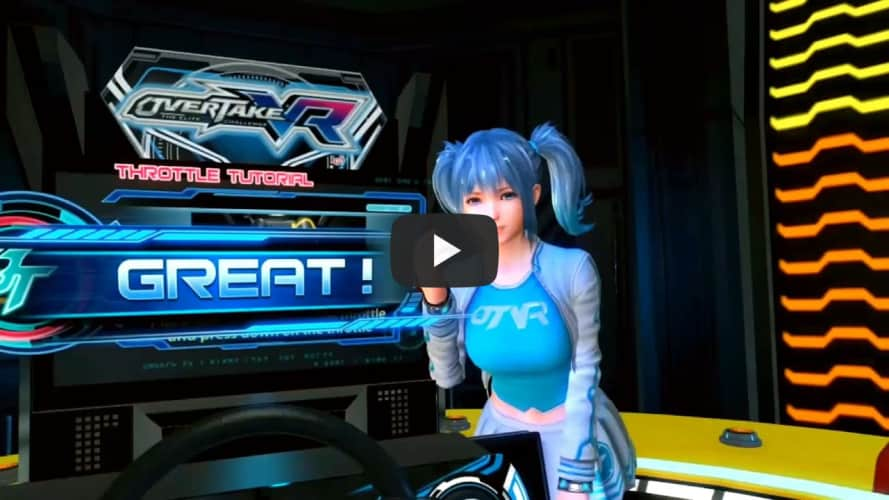
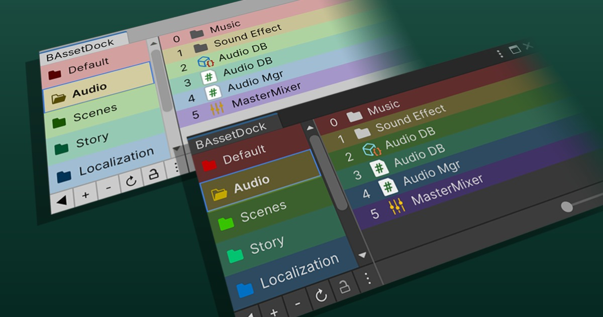
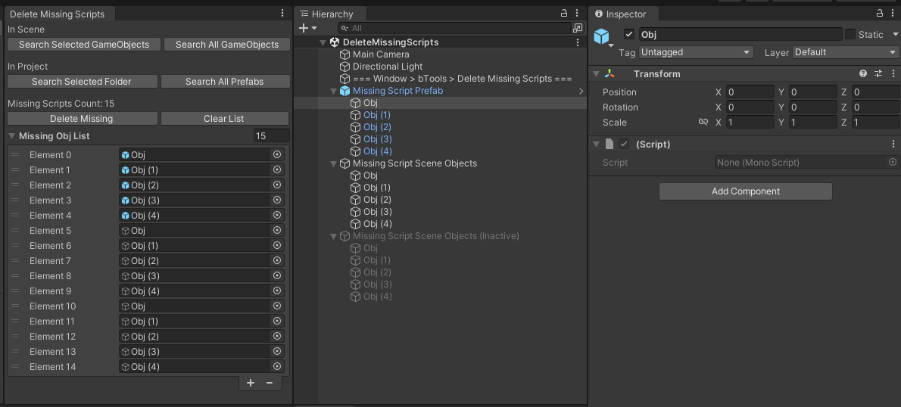
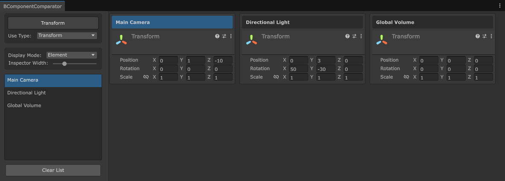
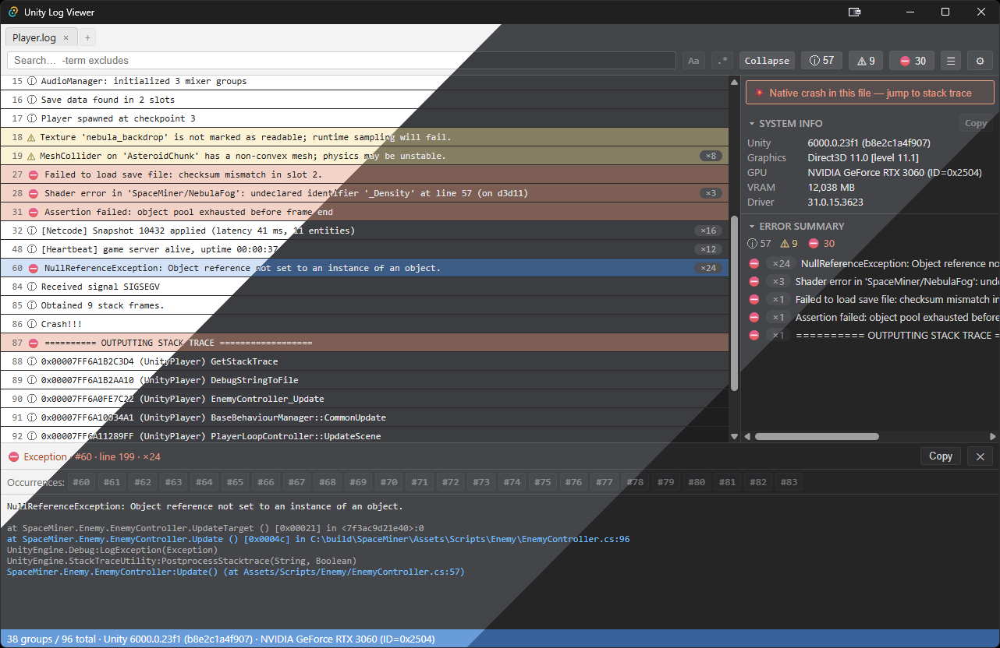
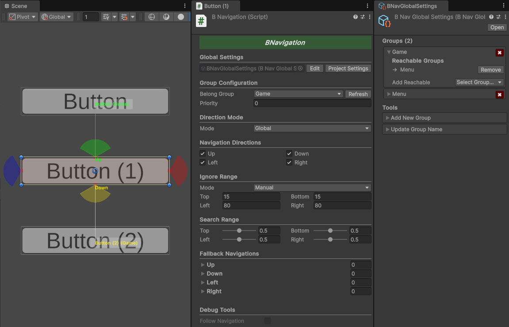

## 💬 About Me

<table style="border:none">
  <tr>
    <td>
      <b>Unity games, dev tools, and AI-assisted development.</b>  
      10+ years Unity · 10+ shipped games · 15+ dev tools  
    </td>
    <td align="center">
      
    </td>
  </tr>
</table>

       

## 🧰 Works

<!-- WORKS:START -->
<table>
  <tr>
    <td width="200"></td>
    <td><b><a href="https://store.steampowered.com/app/2323140/Ringash/">Ringash</a></b> (contributing developer) Top-down 3D action RPG. Steam demo available.</td>
  </tr>
  <tr>
    <td width="200"></td>
    <td><b><a href="https://youtu.be/ucg_tkJpu4o">Racing Game Projects (video)</a></b> Arcade racing games I worked on.</td>
  </tr>
  <tr>
    <td width="200"></td>
    <td><b><a href="https://u3d.as/3vZn">BAssetDock</a></b> Group assets by task instead of digging through the Project window. Open-source predecessor: <a href="https://github.com/bwaynesu/BShortcut">BShortcut</a>  </td>
  </tr>
  <tr>
    <td width="200"></td>
    <td><b><a href="https://github.com/bwaynesu/DeleteMissingScripts">DeleteMissingScripts</a></b> Delete missing script references across scenes and prefabs in one pass.  </td>
  </tr>
  <tr>
    <td width="200"></td>
    <td><b><a href="https://github.com/bwaynesu/BComponentComparator">BComponentComparator</a></b> Compare and edit Components and assets side by side in one window.  </td>
  </tr>
  <tr>
    <td width="200"></td>
    <td><b><a href="https://github.com/bwaynesu/UnityLogViewer">UnityLogViewer</a></b> Read Unity Player.log in a fast offline viewer with search.  </td>
  </tr>
  <tr>
    <td width="200"></td>
    <td><b><a href="https://github.com/bwaynesu/BNav">BNav</a></b> Group Unity UI elements and set navigation rules between groups.  </td>
  </tr>
</table>

More tools

- **[Agentic EBS](https://github.com/bwaynesu/agentic-ebs)** ([live](https://bwaynesu.github.io/agentic-ebs/)): Evidence Based Scheduling experiment with an AI agent as estimator.
- **[BSoundMute](https://github.com/bwaynesu/BSoundMute)**: Mute individual windowed apps on Windows quickly. 
- **[BSelection](https://github.com/bwaynesu/BSelection)**: Select multiple GameObjects in the scene quickly.
- **[OdinEnumArrayTitle](https://github.com/bwaynesu/OdinEnumArrayTitle)**: Name Inspector array elements after an enum (requires Odin Inspector). 
- **[AnyStruct](https://github.com/bwaynesu/AnyStruct)**: Store int, float, byte, and vector values in one zero-boxing struct. 
- **[Steam-Achievement-csv2vdf](https://github.com/bwaynesu/Steam-Achievement-csv2vdf)**: Convert a CSV of achievement text into Steam VDF. 
- **[Gist-Catalog](https://github.com/bwaynesu/Gist-Catalog)**: Catalog of my code snippets, small tools, and technical notes. 

<!-- WORKS:END -->

## 📝 Featured Tool Articles

- [[Tools] Unity Log Viewer: No More Reading Player.log in a Text Editor](https://medium.com/@bwaynesu/tools-unity-log-viewer-no-more-reading-player-log-in-a-text-editor-31103c33cddd)
- [[Tools] BComponentComparator — Stop Repeatedly Switching Unity Inspector!](https://medium.com/@bwaynesu/tools-bcomponentcomparator-stop-repeatedly-switching-unity-inspector-686f3a8a2e2a)
- [[Tools] Unity — From BShortcut to BAssetDock: My journey to make finding assets less painful in Unity](https://medium.com/@bwaynesu/tools-unity-from-bshortcut-to-bassetdock-my-journey-to-make-finding-assets-less-painful-in-2fc8e37c7a69)
- [[Tools] Unity — Delete Missing Script Components](https://medium.com/@bwaynesu/tools-unity-delete-missing-script-components-70fffba1ea8b)

## ✒️ Latest Posts

<!-- BLOG-POST-LIST:START -->
- [[Tools] Unity Log Viewer: No More Reading Player.log in a Text Editor](https://medium.com/@bwaynesu/tools-unity-log-viewer-no-more-reading-player-log-in-a-text-editor-31103c33cddd?source=rss-5e4e7a64353------2)
- [[TIL] Unity — Solving Shared Reactions in Timeline Signals with Custom Markers](https://medium.com/@bwaynesu/til-unity-solving-shared-reactions-in-timeline-signals-with-custom-markers-743a17f586c7?source=rss-5e4e7a64353------2)
- [[TIL] Unity — A Pitfall of Caching Collision Callbacks](https://medium.com/@bwaynesu/til-unity-a-pitfall-of-caching-collision-callbacks-95a7d80a5110?source=rss-5e4e7a64353------2)
- [[Tools] Unity — Avoid Redundant GetComponent!](https://medium.com/@bwaynesu/tools-unity-avoid-redundant-getcomponent-0005f0808d7e?source=rss-5e4e7a64353------2)
- [[TIL] Unity UniTask — Zero GC Async/Await to Replace Coroutines](https://medium.com/@bwaynesu/til-unity-unitask-zero-gc-async-await-to-replace-coroutines-5e902c652242?source=rss-5e4e7a64353------2)
<!-- BLOG-POST-LIST:END -->

## 📋 Stats & Trophies
<a href="https://github-readme-stats-fast.vercel.app"><picture><source media="(prefers-color-scheme: dark)" srcset="https://github-readme-stats-fast.vercel.app/api?&count_private=true&include_all_commits=true&username=bwaynesu&theme=onedark&custom_title=GitHub+Stats&hide_border=true"></picture></a>
<a href="https://github-readme-stats-fast.vercel.app"><picture><source media="(prefers-color-scheme: dark)" srcset="https://github-readme-stats-fast.vercel.app/api/streak?username=bwaynesu&theme=onedark&hide_border=true"></picture></a>

<a href="https://github-trophies.devomb.com"><picture><source media="(prefers-color-scheme: dark)" srcset="https://github-trophies.devomb.com/?username=bwaynesu&row=2&column=4&theme=onedark&no-frame=true"></picture></a>

<!-- https://loading.io/background/m-wave/ -->

